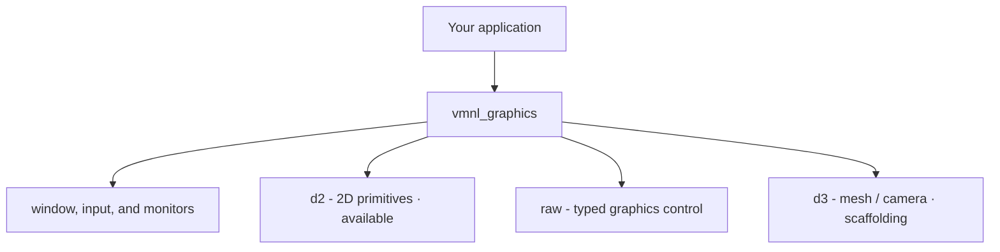

<div align="center">

# VMNL Graphics

**Vulkan graphics, windows, and input for Rust**

A Rust graphics library for games and engines, from useful defaults to explicit low-level control.

<br>


<br>


</div>

---

> [!WARNING]
> **Version `0.1.0` — initial graphics API baseline.** 2D and raw rendering are available within
> their documented limits; 3D rendering remains scaffolded. Platform qualification is incomplete;
> see [Platform Support](https://github.com/VMNL/vmnl-graphics/blob/main/docs/platform_support.md).
> Do not use in production.

## Table of Contents

- [Overview](#overview)
- [Design Principles](#design-principles)
- [Architecture](#architecture)
- [Status](#status)
- [Installation](#installation)
- [Building from Source](#building-from-source)
- [Technical Documentation](#technical-documentation)
- [Roadmap](#roadmap)
- [References](#references)
- [Authors](#authors)
- [License](#license)

---

## Overview

**VMNL Graphics** provides Vulkan rendering, windowing, events, input, and GPU resources for
games, real-time applications, and engines. Applications depend directly on the `vmnl-graphics`
package and import `vmnl_graphics`. The procedural macros used by its raw API are provided through
the same public crate.

| Area | Purpose |
| --- | --- |
| **Windowing and input** | Native windows, events, monitors, keyboard, mouse, and joystick/gamepad access |
| **2D** | Shapes, indexed geometry, and per-object rendering |
| **Raw graphics** | Typed pipelines, geometry, uniform buffers, and explicit frame composition |
| **3D** | Data and resource scaffolding; rendering is not operational |

The guiding constraint is progressive control: start with documented defaults, replace only the
policies that matter, and descend to explicit raw control without changing the conceptual model.

---

## Design Principles

VMNL applies these principles to every stable public contract:

- **Progressive control** - every observable default remains inspectable and replaceable.
- **Predictable costs** - allocations, uploads, synchronization, waits, and managed work are
  documented where they occur.
- **Explicit ownership** - resources, lifetimes, thread affinity, and application-visible state have
  identifiable owners.
- **Scoped determinism** - VMNL claims deterministic behavior only for decisions it controls;
  backend and platform choices are reported explicitly.
- **Composition** - windowing, input, 2D, and raw graphics share explicit ownership and compose
  with the application's own loop and other libraries.
- **Safe defaults** - defaults simplify common use without removing lower-level control or accepting
  invalid public combinations silently.

---

## Architecture



VMNL exposes a control ladder:

- **High-level** - documented defaults and optional helpers for common game/application workflows.
- **Explicit configuration** - callers replace each observable policy relevant to their use case.
- **Raw VMNL** - low-level pipeline, geometry, resource, and synchronization control without making
  Vulkano part of the stable public API.
- **Backend interoperability** - an explicitly unstable escape hatch when raw VMNL is insufficient.

Textures, text, batching, an operational 3D backend, and scene helpers are planned rather than
current capabilities. The canonical direction and boundaries are documented in
[Architecture](https://github.com/VMNL/vmnl-graphics/blob/main/docs/architecture.md).

---

## Status

This documentation describes `vmnl-graphics 0.1.0`. Versioned public contracts follow the
[compatibility policy](https://github.com/VMNL/vmnl-graphics/blob/main/docs/deployment.md#version-and-compatibility-policy);
backend interoperability explicitly marked unstable is excluded.

### Graphics - available

- Vulkan instance / device setup
- Physical device selection (no surface dependency)
- Queue family management
- Swapchain lifecycle
- Render pass + framebuffer
- Graphics pipeline
- Vertex buffers
- Push constants
- Command buffers
- Frame synchronization
- 2D shape primitives (`vmnl_graphics::d2`)
- Render API with explicit 2D / 3D pass separation
- Raw typed pipelines, geometry, and uniform resources within documented limits

### Graphics - scaffolding only

- 3D mesh and camera API (`vmnl_graphics::d3`) - **API exists, rendering not yet implemented**

### Windowing / Input - available

- Event polling
- Monitor enumeration
- Keyboard / mouse input
- Cursor management

### Module overview

| Area                | State            |
| ------------------- | ---------------- |
| Graphics - 2D       | Available        |
| Graphics - 3D       | Scaffolding only |
| Windowing / Input   | Available        |

---

## Installation

The current version is `0.1.0`. Its crates.io publication is pending; use a checkout from a
neighboring application until the package is available on the registry:

```toml
[dependencies]
vmnl-graphics = { path = "../vmnl-graphics/crates/vmnl_graphics" }
```

Import types with `use vmnl_graphics::{Context, Window};`. See
[Deployment](https://github.com/VMNL/vmnl-graphics/blob/main/docs/deployment.md#publication-status-and-prerequisites)
for registry availability and the manual publication procedure. Cargo resolves `vmnl-macros`
transitively; clients do not declare it directly.

### Requirements

- Rust 1.95 or later + Cargo
- Just
- A Vulkan loader (`libvulkan.so`, `vulkan-1.dll`, `libvulkan.dylib`)
- A Vulkan-compatible GPU

---

## Building from Source

```bash
git clone https://github.com/VMNL/vmnl-graphics.git
cd vmnl-graphics
just build-workspace
```

---

## Technical Documentation

Technical documentation starts at [docs/README.md](https://github.com/VMNL/vmnl-graphics/blob/main/docs/README.md).

- [Getting Started](https://github.com/VMNL/vmnl-graphics/blob/main/docs/getting_started.md)
- [Coding Instructions](https://github.com/VMNL/vmnl-graphics/blob/main/docs/INSTRUCTIONS.md)
- [Build and platform support](https://github.com/VMNL/vmnl-graphics/blob/main/docs/build.md)
- [Testing](https://github.com/VMNL/vmnl-graphics/blob/main/docs/testing.md)

---

## Roadmap

1. **`0.1.0` (current)** - window/input, 2D shapes, and minimal raw graphics form the initial
   graphics API baseline; documented implementation and qualification limits still apply.
2. **`0.2.0`** - textures without breaking `0.1.0`; text and batching begin in parallel.
3. **Later `0.x`** - optional graphics composition helpers, operational 3D, and reference applications.
4. **`1.0.0`** - complete stable graphics APIs, qualified platform support, stable C ABI, priority
   C++ wrapper, and demonstrated game and engine rendering workflows.

VMNL preserves published `0.x` Rust contracts after `0.1.0`; deprecated APIs remain until `1.0.0`.
See [Deployment](https://github.com/VMNL/vmnl-graphics/blob/main/docs/deployment.md) for the exact compatibility, release, and distribution policy.

---

## References

- [Vulkan Specification](https://registry.khronos.org/vulkan/) - Khronos Group
- [Vulkano](https://vulkano.rs/) - Rust Vulkan wrapper
- [GLFW](https://www.glfw.org/) - windowing / input reference

---

## Authors

Original VMNL project contributors and their historical roles:

| Name | Historical role |
| ---- | ---- |
| [Hugo Duda](https://github.com/HugoDuda) | Product Owner · Graphics Lead (low-level & high-level) |
| [Maxence Pierre](https://github.com/Anexoms) | Low-level developer |
| [Nathan Flachat](https://github.com/NathanFlachat) | Low-level & high-level developer |
| [Naouel Bouhali](https://github.com/BouhaliNaouel) | High-level developer |
| [Julien Michel](https://github.com/JulienMICHELgithub) | Web Lead |
| [Laszlo Serdet](https://github.com/lszsrd) | Networking Lead |

---

## License

See [LICENSE](LICENSE).
